author: Chanin Nantasenamat
id: build-r-python-drug-discovery-apps-and-agents
categories: snowflake-site:taxonomy/solution-center/certification/quickstart, snowflake-site:taxonomy/product/ai, snowflake-site:taxonomy/product/applications-and-collaboration, snowflake-site:taxonomy/snowflake-feature/snowpark, snowflake-site:taxonomy/snowflake-feature/cortex-analyst, snowflake-site:taxonomy/snowflake-feature/cortex-search, snowflake-site:taxonomy/industry/healthcare-and-life-sciences
language: en
summary: Train an R QSAR model for aromatase inhibition, serve it with R Plumber on Snowpark Container Services, and expose it through Streamlit, MCP, and Cortex Agents.
environments: web
status: Published
feedback link: https://github.com/Snowflake-Labs/sfquickstarts/issues
fork repo link: https://github.com/sfc-gh-cnantasenamat/qsar-r-py-snowflake

# Build R and Python Powered Drug Discovery Apps and Agents on Snowflake

## Overview

Drug discovery generates some of the richest and most sensitive data in industry, and R is the language of choice for computational chemists and researchers who rely on its modeling and cheminformatics ecosystem. Yet a persistent gap remains between where machine learning models are built and where they deliver value. Suppose a medicinal chemist in your lab wants to investigate letrozole analogs against human aromatase (`CYP19A1`, ChEMBL target `CHEMBL1978`), the enzyme that converts androgens into estrogens. Prolonged or high estrogen exposure is linked to increased breast cancer risk, and some hormone-receptor-positive breast cancers rely on estrogen to grow; blocking aromatase's catalytic site reduces estrogen biosynthesis, which is why aromatase inhibitors such as letrozole, anastrozole, and exemestane are widely studied. Building on published quantitative structure-activity relationship (QSAR) and proteochemometric studies of aromatase inhibitors ([Worachartcheewan et al., 2014](https://www.sciencedirect.com/science/article/abs/pii/S0169743914001646); [Shoombuatong et al., 2015](https://pmc.ncbi.nlm.nih.gov/articles/PMC4614109/); [Simeon et al., 2016](https://peerj.com/articles/1979/); [Shoombuatong et al., 2018](https://pmc.ncbi.nlm.nih.gov/articles/PMC6123608/)), a QSAR model trained in R can estimate a molecule's inhibitory potency (`pIC50`, the negative base-10 logarithm of the molar `IC50` concentration) from its chemical structure. The experimental X-ray crystal structure below (RCSB Protein Data Bank entry [3EQM](https://www.rcsb.org/structure/3EQM), determined at 2.90 angstrom resolution) shows human placental aromatase (`CYP19A1`) complexed with its natural androgen substrate androstenedione and a heme cofactor near the active site.

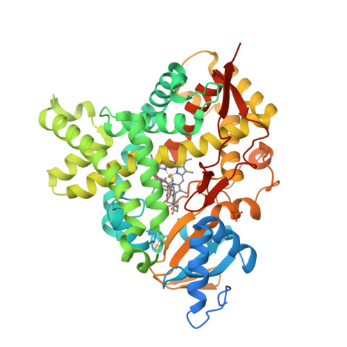

In most labs, however, a working R model for a target like aromatase lives in an ad hoc script on its author's laptop reading local CSV files, or on an on-premises high-performance computing (HPC) rack that demands dedicated floor space, upgraded power, continuous cooling, and outside specialists whenever hardware or software faults strike. If the rack eventually fails and important data cannot be recovered, or if colleagues cannot reproduce the data, molecular features, and model behind a score ([Schaduangrat et al., 2020](https://link.springer.com/article/10.1186/s13321-020-0408-x)), the model never becomes a shared organizational asset. Teams often assume that moving to production requires abandoning R and rebuilding in another language, a costly detour that sidelines the researchers who understand the science best. Rather than choosing between languages, this guide combines R and Python on Snowflake to get the best of both worlds, treating the R pipeline as a first-class, version-controlled, containerized production artifact rather than an afterthought. We structure the workflow into deterministic, testable stages (data preprocessing, molecular feature engineering, model training, and scoring) that run against governed enterprise tables instead of local files: in R, `rcdk` computes 1,024-bit Extended-Connectivity Fingerprints (ECFP4) with the Chemistry Development Kit (CDK), `caret` filters near-zero-variance bits, `ranger` trains a 500-tree quantile random forest, and an R Plumber API serves the saved model inside a container on Snowpark Container Services so it runs identically in development and production. Python and Snowflake handle data curation, governance, and two complementary ways for bench scientists and AI assistants to query predictions without touching code: Snowflake Notebooks curate ChEMBL bioactivity measurements and compute RDKit descriptors, SQL service functions expose the R container to warehouse queries, a Streamlit in Snowflake frontend lets scientists submit compounds interactively, a Model Context Protocol (MCP) server exposes six R tools conversationally to AI chat clients, and an optional Cortex Agent combines Cortex Analyst, Cortex Search, and R-backed tools for governed cohort questions, assay literature retrieval, and candidate triage.

In practice, you trace a known aromatase inhibitor such as letrozole (`CHEMBL1444`) from raw public bioactivity records through the containerized R pipeline and back as an interpretable result, while addressing the realities of shipping AI in a regulated domain: keeping proprietary chemistry inside platform-governed storage and private or managed models, monitoring model and pipeline health, and controlling compute cost as usage grows. Starting from 7,040 raw ChEMBL activity records for human aromatase, the curation pipeline filters for exact binding-assay `IC50` measurements in nanomolar units and deduplicates to 2,751 unique compounds (1,061 measured Active at `pIC50 >= 6.5`, or about `316 nM` and below), where letrozole has a selected measured `pIC50` of `9.15`. When a scientist submits letrozole's Simplified Molecular Input Line Entry System (SMILES) string through the Streamlit app, SQL, or MCP, the R Plumber service encodes the structure with the exact fingerprint recipe used in training and returns a predicted `pIC50` (`7.89` in the bundled model, with uncalibrated 5th to 95th percentile model quantiles of `5.79` to `9.22`) alongside measured cohort context so colleagues never confuse a model score with an experimental assay. The next section summarizes the specific skills you will gain along this journey.

### What You'll Learn
- How to curate and standardize ChEMBL bioactivity records for human aromatase in a Snowflake Notebook
- How to encode SMILES strings as 1,024-bit ECFP4 circular fingerprints with `rcdk` and train a quantile random forest with `ranger` in R
- How to prevent feature-selection leakage by splitting training and test sets before filtering near-zero-variance fingerprint bits
- How to package an R model, its ordered feature list, and a Plumber API as a container service on Snowpark Container Services
- How to authenticate to a public Snowpark Container Services endpoint using a programmatic access token (PAT)
- How to connect the R service to SQL service functions, a multipage Streamlit in Snowflake app, an external MCP client, and an optional Cortex Agent
- Which statistical, operational, and governance limitations to check before another scientist depends on the service

Now that you know the skills covered in this tutorial, review the prerequisites required to run the workflow in your own environment.

### What You'll Need
- Access to a [Snowflake account](https://signup.snowflake.com/?utm_source=snowflake-devrel&utm_medium=developer-guides&utm_cta=developer-guides) with `ACCOUNTADMIN` access for the one-time setup
- [Docker](https://www.docker.com/) with `linux/amd64` build support
- [Snowflake CLI](https://docs.snowflake.com/en/developer-guide/snowflake-cli/index) configured with a connection to your account
- Python 3.11 or later with `requests`, `pandas`, `toml`, `rdkit`, and `snowflake-connector-python`
- Basic familiarity with R, Python, and SQL

With those prerequisites in place, let us look at the architecture and components you will assemble.

### What You'll Build
You will build AromatasePred, an end-to-end R and Python drug discovery application for predicting human aromatase inhibition:

- A biological target and curation workflow in a Snowflake Notebook that transforms raw ChEMBL records for human aromatase (`CHEMBL1978`) into 2,751 deduplicated compounds with exploratory analysis and Lipinski Rule-of-Five descriptors
- An R training script that computes CDK ECFP4 fingerprints, selects informative bits, fits a 500-tree `ranger` quantile random forest, and exports paired model and feature artifacts
- An R Plumber container service on Snowpark Container Services exposing `/health`, `/predict`, `/sf/*` SQL service-function routes, and `/mcp`
- Shared SQL functions (`PREDICT_PIC50`, `ECFP4`, `SIMILAR_COMPOUNDS`, `EXPLAIN_PREDICTION`, and RDKit `RO5`) and a second Snowflake Notebook that batch-scores the 2,751 compounds
- A multipage Streamlit in Snowflake app with Dashboard, Single Prediction, Batch Prediction, About, and optional Ask an Agent pages
- An MCP server exposing six R tools to AI chat clients, plus an optional Cortex Agent backed by a semantic view (`AROMATASE_SV`), a Cortex Search service (`ASSAY_SEARCH`), and a candidate triage procedure (`TRIAGE_COMPOUNDS`)

The four-lane architecture diagram below maps every data handoff and calling route across the system.

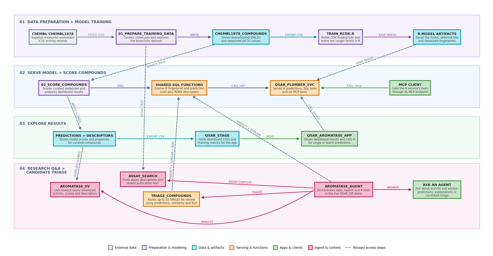

1. **Lane 1: Data Preparation and R Training.** Notebook 01 fetches ChEMBL bioactivity records for `CHEMBL1978`, curates 2,751 non-redundant compounds into `CHEMBL1978_COMPOUNDS`, and exports `chembl1978_cleaned.csv` to `@QSAR_STAGE`. The R training script (`docker/train_rcdk.R`) reads that CSV, computes 1,024-bit CDK ECFP4 fingerprints, selects informative bits, and trains the 500-tree `ranger` quantile random forest.
2. **Lane 2: R Serving and Batch Scoring.** The saved `.rds` model, ordered `kept_bits.csv` list, and measured fingerprints are packaged into the R Plumber service (`QSAR_PLUMBER_SVC`) on Snowpark Container Services. Shared SQL functions (`sql/functions.sql`) wrap the service endpoints so Notebook 02 can score all 2,751 compounds and store predictions, fingerprints, and descriptors for downstream analytics.
3. **Lane 3: Scientist App and MCP Access.** Prepared stage summaries (`dashboard_eda.csv`, `dashboard_ro5.csv`, `dashboard_predictions.csv`, `top_features.csv`, and `training_metrics.json`) feed the Streamlit Dashboard and About pages, while Single and Batch Prediction send live SMILES requests to `/predict`. External AI chat clients connect to `/mcp` over HTTPS using a PAT to invoke the six R tools directly.
4. **Lane 4: Optional Cortex Agent and Candidate Triage.** When enabled, `AROMATASE_AGENT` routes measured-cohort questions to Cortex Analyst (`AROMATASE_SV`), assay and publication text questions to Cortex Search (`ASSAY_SEARCH`), and structure scoring or candidate prioritization (`TRIAGE_COMPOUNDS`, capped at 20 SMILES) to the shared SQL functions. Solid arrows denote steps within a lane, while dashed arrows denote cross-lane artifact and service calls.

Now that you have a clear map of the architecture, you can clone the companion repository and provision the Snowflake environment.

## Setup

Before running any notebooks or container builds, you need a local copy of the project files and the Snowflake role, warehouse, database, compute pools, and external access integrations that host the workflow.

### Clone the Repository

**Run this step:** Open a terminal and clone the companion repository to your local machine.

```bash
git clone https://github.com/sfc-gh-cnantasenamat/qsar-r-py-snowflake.git
cd qsar-r-py-snowflake
```

The repository is organized by architectural layer:

| Folder | Contents |
|---|---|
| `data/` | Snapshot of the cleaned `CHEMBL1978` dataset (2,751 compounds) used for the bundled model |
| `docker/` | R training script (`train_rcdk.R`), Plumber API (`plumber_api.R`), `Dockerfile.plumber`, SPCS specification, and bundled model artifacts |
| `streamlit/` | Multipage Streamlit app (`app.py`, `_shared.py`, and page modules) |
| `notebooks/` | `01_prepare_training_data.ipynb` (curation and EDA) and `02_score_compounds.ipynb` (batch scoring and agent tables) |
| `native_app/` | Optional Snowflake Native App package for per-consumer MCP deployment |
| `scripts/` | Endpoint smoke test (`test_endpoint.py`), dashboard data generator, and optional agent deployment script |
| `sql/` | Snowflake setup (`setup.sql`), shared SQL functions (`functions.sql`), and optional agent DDL (`agent.sql`) |
| `agent/` | Optional Cortex Agent specification (`aromatase_agent.yaml`) and 15-case evaluation fixtures |
| `docs/` | Standalone MCP client walkthrough (`mcp-walkthrough.md`) |

With the repository on disk, the next step is creating the Snowflake objects that own and run the pipeline.

### Create Snowflake Objects

**Run this step:** Open `sql/setup.sql` in a Snowsight SQL worksheet, replace `<your_user>` with your Snowflake username, and run steps 1 through 4. The script provisions:

- `QSAR_ROLE`, a dedicated role that owns all project objects and is granted to `SYSADMIN`
- `QSAR_WH`, an extra-small warehouse for SQL queries
- `QSAR_DB` with stage `QSAR_STAGE`, image repository `QSAR_REPO`, and audit table `QSAR_PREDICTIONS_LOG`
- `QSAR_CPU_POOL`, a single-node `CPU_X64_S` compute pool for the R Plumber service
- `QSAR_ST_POOL`, a small `CPU_X64_XS` compute pool for the Streamlit container runtime and notebook runs
- `QSAR_APP_EAI`, an external access integration allowing the app to install packages from PyPI and optionally query PubChem
- `QSAR_NB_EAI`, an external access integration allowing the notebooks to fetch ChEMBL bioactivity data and install `rdkit`

Review the core role, compute pool, and privilege grants from **sql/setup.sql** below (run the full `sql/setup.sql` script in Snowsight):

```sql
USE ROLE ACCOUNTADMIN;

CREATE ROLE IF NOT EXISTS QSAR_ROLE;
GRANT ROLE QSAR_ROLE TO USER <your_user>;
-- SYSADMIN (and so ACCOUNTADMIN) inherits QSAR_ROLE, so admin CLI connections can use its objects
GRANT ROLE QSAR_ROLE TO ROLE SYSADMIN;

CREATE COMPUTE POOL IF NOT EXISTS QSAR_CPU_POOL
    MIN_NODES = 1
    MAX_NODES = 1
    INSTANCE_FAMILY = CPU_X64_S
    AUTO_RESUME = TRUE
    AUTO_SUSPEND_SECS = 3600
    COMMENT = 'QSAR aromatase SPCS inference';
GRANT USAGE, MONITOR ON COMPUTE POOL QSAR_CPU_POOL TO ROLE QSAR_ROLE;
GRANT BIND SERVICE ENDPOINT ON ACCOUNT TO ROLE QSAR_ROLE;
GRANT DATABASE ROLE SNOWFLAKE.PYPI_REPOSITORY_USER TO ROLE QSAR_ROLE;
```

`QSAR_ROLE` owns everything created in this guide. Because `sql/setup.sql` grants `QSAR_ROLE` to `SYSADMIN`, Snowflake CLI commands also work from a connection whose default role is `SYSADMIN` or `ACCOUNTADMIN`.

**Check:** Run the verification query below in a Snowsight worksheet to confirm that `QSAR_ROLE` holds the required warehouse, compute pool, integration, and endpoint privileges.

```sql
USE ROLE QSAR_ROLE;
USE WAREHOUSE QSAR_WH;
SHOW GRANTS TO ROLE QSAR_ROLE;
SELECT "privilege", "granted_on", "name"
FROM TABLE(RESULT_SCAN(LAST_QUERY_ID()))
WHERE "granted_on" IN ('WAREHOUSE', 'COMPUTE_POOL', 'INTEGRATION', 'ACCOUNT')
ORDER BY 2, 3, 1;
```

You should see eight rows in this filtered result: `BIND SERVICE ENDPOINT` on the account, `USAGE` and `MONITOR` on `QSAR_CPU_POOL` and `QSAR_ST_POOL`, `USAGE` on `QSAR_APP_EAI` and `QSAR_NB_EAI`, and `USAGE` on `QSAR_WH`. The `SNOWFLAKE.PYPI_REPOSITORY_USER` database role is a separate grant that lets `RO5()` pin the notebook's RDKit version. Record the `repository_url` returned by `SHOW IMAGE REPOSITORIES` at the end of `sql/setup.sql`, as you will push the R container image to that URL.

With the Snowflake role, pools, stage, and external access integrations ready, you can now curate the experimental ChEMBL bioactivity records that ground the R model.

## Prepare Training Data

Before training any model, you must decide which experimental measurements count and standardize them into a single, non-redundant table. An `IC50` value is the concentration associated with 50% inhibition in an assay, whereas a model prediction is an estimate rather than a new measurement.

### Curate the Cohort

`notebooks/01_prepare_training_data.ipynb` applies a four-stage curation funnel to public ChEMBL records for human aromatase (`CHEMBL1978`):

1. **Source (`7,040` activity records):** Queries the ChEMBL REST API for all bioactivity records associated with target `CHEMBL1978`.
2. **Select (`3,960` `IC50` records):** Filters for binding assays (`assay_type = 'B'`) with exact potency measurements (`standard_type = 'IC50'` and `standard_relation = '='`), leaving out `Ki`, `Kd`, `EC50`, and censored inequalities, and saves them to `CHEMBL1978_RAW_ACTIVITIES` alongside 313 assay descriptions (`CHEMBL1978_ASSAYS`) and 198 publication records (`CHEMBL1978_DOCUMENTS`).
3. **Standardize (`pIC50`):** Retains nanomolar (`nM`) records that have both a valid canonical SMILES string and a `pChEMBL` value (`-log10` of molar potency, which equals `pIC50` here because only `IC50` records were selected).
4. **Remove redundancy (`2,751` compounds):** Deduplicates repeat measurements per `molecule_chembl_id` by keeping the highest measured `pIC50` and labels compounds Active (`1`) at `pIC50 >= 6.5` (about `316 nM` or lower) and Inactive (`0`) below `6.5`, saving `1,061` active and `1,690` inactive molecules to `CHEMBL1978_COMPOUNDS`.

> **Note:** Keeping the highest measured `pIC50` per molecule is this tutorial's modeling choice and can overrepresent stronger reported activity across heterogeneous cell-based and recombinant enzyme assays. It is not a universal assay-reconciliation rule.

Now that you understand the four curation decisions, upload and execute Notebook 01 in Snowflake.

### Run the Notebook

**Run this step:** In a Snowsight SQL worksheet, create a stage to hold the notebook files.

```sql
USE ROLE QSAR_ROLE;
USE WAREHOUSE QSAR_WH;
USE SCHEMA QSAR_DB.PUBLIC;
CREATE STAGE IF NOT EXISTS NB_PROJECT_STAGE;
```

**Run this step:** From the cloned repository root in your local terminal, upload both notebooks to `@QSAR_DB.PUBLIC.NB_PROJECT_STAGE` (`PUT` reads local files, so run it from the terminal rather than a Snowsight worksheet).

```bash
snow sql -q "PUT file://notebooks/*.ipynb @QSAR_DB.PUBLIC.NB_PROJECT_STAGE AUTO_COMPRESS=FALSE OVERWRITE=TRUE"
```

**Run this step:** Back in the Snowsight SQL worksheet, create the notebook project from `@NB_PROJECT_STAGE` and execute `01_prepare_training_data.ipynb` on `QSAR_ST_POOL` with `QSAR_NB_EAI` attached.

```sql
CREATE OR REPLACE NOTEBOOK PROJECT QSAR_NOTEBOOKS FROM '@NB_PROJECT_STAGE';

EXECUTE NOTEBOOK PROJECT QSAR_NOTEBOOKS
    MAIN_FILE = '01_prepare_training_data.ipynb'
    COMPUTE_POOL = 'QSAR_ST_POOL'
    QUERY_WAREHOUSE = 'QSAR_WH'
    RUNTIME = 'V2-CPU-PY3.12'
    EXTERNAL_ACCESS_INTEGRATIONS = (QSAR_NB_EAI);
```

The execution takes about three minutes and writes `chembl1978_cleaned.csv`, `dashboard_eda.csv`, and `dashboard_ro5.csv` to `@QSAR_STAGE`. You can also open the notebook interactively in Snowsight Workspaces on a Container Runtime (`V2-CPU-PY3.12`) with `QSAR_NB_EAI` enabled to inspect the exploratory plots cell by cell.

Once the notebook run finishes, verify the curated table counts and stage outputs.

### Check the Result

**Check:** Run the query below in Snowsight to confirm that `CHEMBL1978_COMPOUNDS` contains `2,751` compounds and `1,061` active molecules (from ChEMBL 37; a newer ChEMBL release can change these counts).

```sql
USE ROLE QSAR_ROLE;
USE WAREHOUSE QSAR_WH;
SELECT COUNT(*) AS N_COMPOUNDS, SUM(ACTIVITY_CLASS) AS N_ACTIVE
FROM QSAR_DB.PUBLIC.CHEMBL1978_COMPOUNDS;
```

The image below is a locally rendered summary of the verified table counts (`3,960` raw `IC50` records, `2,751` curated compounds, `1,061` active compounds, `313` assays, and `198` publications) from the isolated `QSAR_AG` test environment, rather than a Snowsight worksheet screenshot.

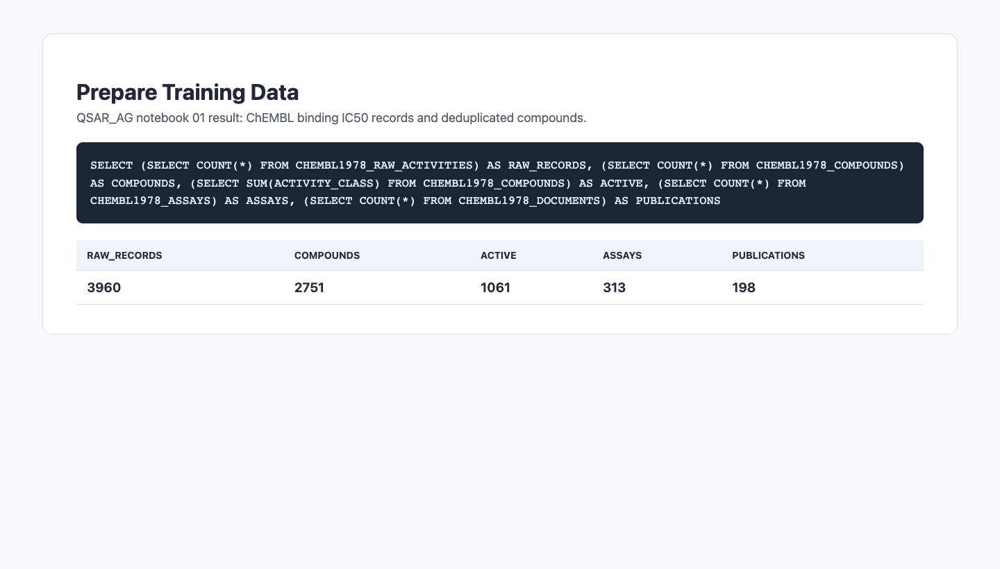

The local preview below shows the Dataset Overview charts generated from the curated `QSAR_AG` data, illustrating the `pIC50` distribution around the `6.5` threshold and the `38.6%` active vs `61.4%` inactive class balance.

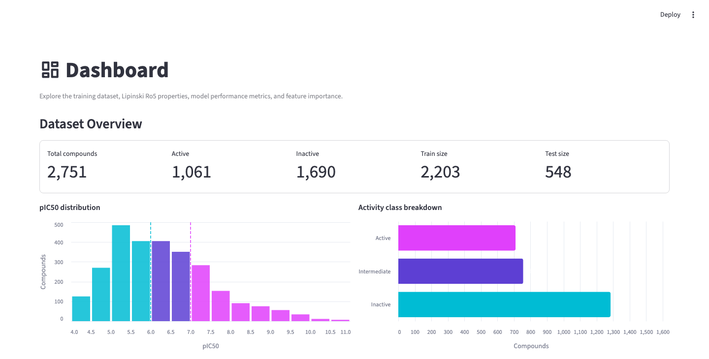

Notebook 01 also computes Lipinski Rule-of-Five physicochemical properties (`MW <= 500 Da`, `LogP <= 5`, `HBD <= 5`, `HBA <= 10`) using RDKit. The local preview below renders those descriptor distributions by activity class from the isolated test data.

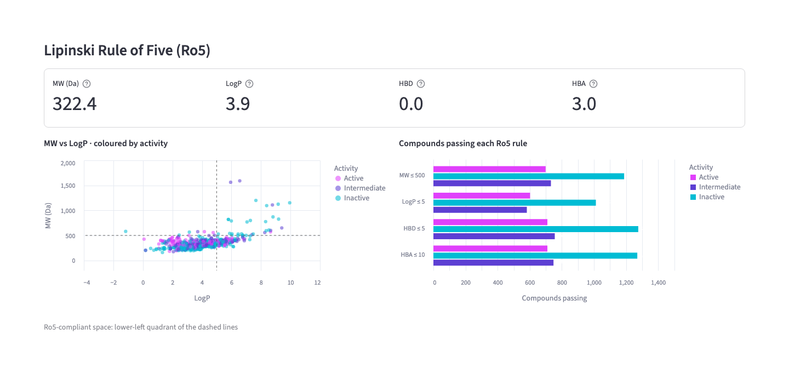

With `2,751` curated aromatase compounds and `chembl1978_cleaned.csv` staged in Snowflake, you are ready to encode the molecular structures and train the quantile random forest in R.

## Train the R Model

A random forest cannot consume raw SMILES text directly. In this section, you inspect how `docker/train_rcdk.R` converts each molecule into a binary fingerprint, splits the dataset before feature selection to avoid test-set leakage, and fits a 500-tree `ranger` quantile random forest.

### Get the Training Data

**Run this step:** Download `chembl1978_cleaned.csv` from `@QSAR_DB.PUBLIC.QSAR_STAGE` into your local `data/` directory (or keep the repository's existing `data/chembl1978_cleaned.csv` snapshot if you want to reproduce the bundled model's exact row order).

```bash
snow sql -q "GET @QSAR_DB.PUBLIC.QSAR_STAGE/chembl1978_cleaned.csv file://data/"
```

Review the first row of **data/chembl1978_cleaned.csv** below (no action required) to see the schema consumed by R:

```text
molecule_chembl_id,canonical_smiles,standard_value,pchembl_value,activity_class
CHEMBL4632445,CCC#CCOc1ccc2c(=O)c3ccc(Cn4ccnc4)cc3oc2c1,0.01,11.0,1
```

Next, examine how `rcdk` turns each `canonical_smiles` string into model features.

### Compute Fingerprints

> **Note:** The R snippets in this subsection and the next are already in `docker/train_rcdk.R` on disk. Review them to understand the feature contract before running the training container.

Review the fingerprint calculation in **docker/train_rcdk.R** below (no action required) to see how CDK parses each SMILES string and hashes circular atom neighborhoods up to bond depth 2 (`ECFP4`) into a 1,024-position vector of `1`s and `0`s:

```r
fps <- lapply(mols, function(mol) {
  fp <- get.fingerprint(mol, type = "circular", circular.type = "ECFP4",
                        depth = 2, size = 1024)
  v  <- integer(1024)
  v[fp@bits] <- 1L
  v
})
```

Because circular substructures are folded into 1,024 fixed positions by hashing, a bit indicates the presence of one or more local atom patterns (and hash collisions can occur). To prevent data leakage from the test set into feature selection, `docker/train_rcdk.R` splits the molecules 80/20 (`2,203` training rows and `548` test rows) first and then runs `caret::nearZeroVar()` on the training matrix only, saving the ordered list of kept bit names (`kept_bits_rcdk.csv`) and selecting those exact columns in the test matrix.

Review the split-first feature filter in **docker/train_rcdk.R** below (no action required):

```r
train_idx <- as.vector(createDataPartition(df$pchembl_value, p = 0.8, list = FALSE))
train_x   <- fp_matrix[ train_idx, , drop = FALSE]
test_x    <- fp_matrix[-train_idx, , drop = FALSE]

nzv_idx <- nearZeroVar(train_x, saveMetrics = FALSE)
if (length(nzv_idx) > 0) train_x <- train_x[, -nzv_idx, drop = FALSE]
kept <- colnames(train_x)
test_x <- test_x[, kept, drop = FALSE]
stopifnot(identical(colnames(train_x), colnames(test_x)))
```

With the training matrix filtered to its informative bits, the script fits the quantile random forest.

### Train a Quantile Forest

Review the `ranger` call in **docker/train_rcdk.R** below (no action required) to see how the 500-tree regression forest is trained with `quantreg = TRUE` and regression impurity (`variance`) feature importance:

```r
model <- ranger(
  target ~ .,
  data       = train_df,
  num.trees  = 500,
  importance = "impurity",
  quantreg   = TRUE,
  seed       = 42
)
```

Notice that this is a regression model over continuous `pIC50`, not a separate binary classifier: the `Active` (`pIC50 >= 6.5`) and `Inactive` (`< 6.5`) labels are derived by thresholding the predicted median `pIC50`. Setting `quantreg = TRUE` allows the serving API to output the 5th, 50th (median), and 95th percentiles across the forest for each query molecule.

Now let us run the training script inside the same Docker image used for serving so that Java, CDK, `rcdk`, and `ranger` versions match byte for byte.

### Run Training in Docker

**Run this step:** From the repository root, build the local R Plumber image and execute `docker/train_rcdk.R` inside a container with `data/`, `output/`, and `docker/` mounted.

```bash
docker build --platform linux/amd64 -f docker/Dockerfile.plumber -t r-qsar-plumber:local docker
mkdir -p output
docker run --rm --platform linux/amd64 \
  -v "$PWD/data:/data" -v "$PWD/output:/output" -v "$PWD/docker:/work" \
  r-qsar-plumber:local Rscript /work/train_rcdk.R
```

**Check:** Inspect `output/training_metrics.json` after the container finishes. When trained on the repository's `data/chembl1978_cleaned.csv` snapshot with the split-first `nearZeroVar()` filter, the script retains `180` bits and writes the following metrics to **output/training_metrics.json**:

```json
{
  "oob_r2": 0.6505,
  "test_r2": 0.6843,
  "test_rmse": 0.7721,
  "n_compounds": 2751,
  "n_active": 1061,
  "n_train": 2203,
  "n_test": 548,
  "n_bits": 180,
  "n_trees": 500,
  "fingerprint": "CDK ECFP4 (rcdk 3.8.2)",
  "model": "ranger quantile RF"
}
```

> **Note:** Always deploy `qsar_aromatase_model.rds` and `kept_bits.csv` as a matched pair, never mixing a model file from one run with the bit list from another. The repository's pre-bundled `docker/` artifacts were produced by an earlier run (`178` bits, `test_r2: 0.6855`, `test_rmse: 0.7708`, or `test_r2: 0.6537` and `test_rmse: 0.7949` when trained on Notebook 01's row order). If you want to serve your freshly trained model, copy all five outputs from `output/` into `docker/` before building the serving image.

**Run this step:** Copy the newly trained model, ordered bit list, top features, metrics, and fingerprints from `output/` into `docker/` if you want the container build to bake in your retrained artifacts (skip this copy if you prefer to deploy the repository's pre-bundled 178-bit artifacts).

```bash
cp output/qsar_aromatase_model_rcdk.rds docker/qsar_aromatase_model.rds
cp output/kept_bits_rcdk.csv docker/kept_bits.csv
cp output/top_features_rcdk.csv output/training_metrics.json output/train_fingerprints.csv docker/
```

The local preview below illustrates the bundled model's predicted-versus-measured scatter plot and residual distribution from the isolated `QSAR_AG` dashboard files.

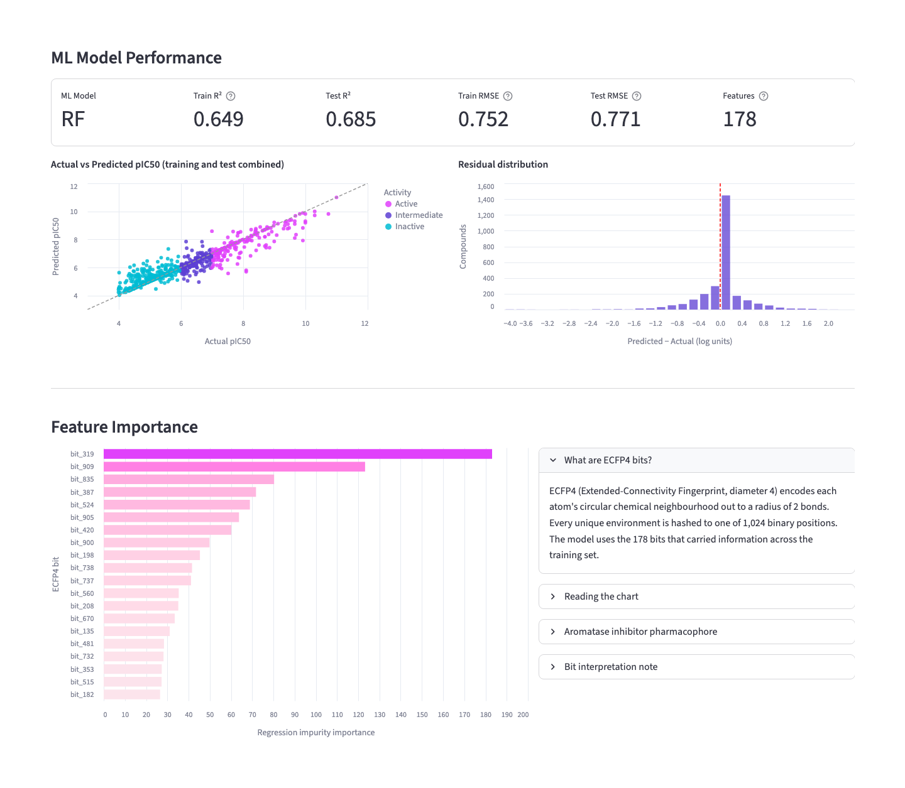

The local preview below shows the top ECFP4 fingerprint bits ranked by regression impurity importance (`variance` reduction across trees).

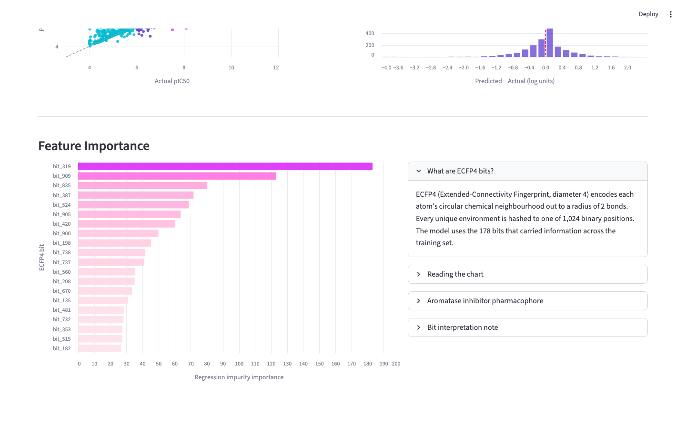

Having trained the quantile random forest and paired it with its ordered bit list, you can now package and serve the R model as an API on Snowpark Container Services.

## Serve With R Plumber

To make the saved R model callable by colleagues, SQL queries, apps, and AI assistants without requiring anyone to install R or Java locally, `docker/plumber_api.R` wraps the model in an HTTP service on Snowpark Container Services.

### Inspect the API

`docker/plumber_api.R` loads `qsar_aromatase_model.rds`, `kept_bits.csv`, `training_metrics.json`, and `train_fingerprints.csv` once at container startup and warms up the `rcdk` Java Virtual Machine (JVM). Its primary endpoints are:

| Endpoint | Purpose |
|---|---|
| `GET /health` | Container readiness probe returning status, tree count, and feature count |
| `POST /predict` | Direct batch prediction endpoint used by the Streamlit app and smoke test |
| `POST /sf/predict`, `/sf/fingerprint`, `/sf/similar`, `/sf/explain` | Snowflake service-function routes for calling R from SQL |
| `POST /mcp` | Standalone MCP server over JSON-RPC 2.0 exposing six R tools |

When a SMILES string arrives, the service executes a four-stage inference contract:

1. **Parse:** CDK parses the SMILES string into a molecular graph and returns an explicit error if the syntax is invalid.
2. **Encode:** `get.fingerprint()` computes the 1,024-bit ECFP4 vector, and `fp_df[, kept_bits, drop = FALSE]` selects the exact ordered columns expected by the forest.
3. **Predict:** `predict(model, data = fp_df, type = "quantiles", quantiles = c(0.05, 0.5, 0.95))` returns the 5th percentile, median (`pIC50`), and 95th percentile across the 500 trees.
4. **Label:** A predicted median `pIC50 >= 6.5` is labeled `Active`, and `< 6.5` is labeled `Inactive`.

Review the feature-parity and quantile prediction lines from **docker/plumber_api.R** below (no action required):

```r
fp_obj <- get.fingerprint(mol, type = "circular",
  circular.type = "ECFP4", depth = 2, size = 1024)
fp_vec <- integer(1024)
fp_vec[fp_obj@bits] <- 1L
fp_df  <- as.data.frame(t(fp_vec))
colnames(fp_df) <- paste0("bit_", seq_len(1024))
fp_df  <- fp_df[, kept_bits, drop = FALSE]
pred   <- predict(model, data = fp_df, type = "quantiles",
                  quantiles = c(0.05, 0.5, 0.95))
```

Now build the container image and push it to your Snowflake image repository.

### Build and Push

**Run this step:** Authenticate Docker to your Snowflake image registry, build `Dockerfile.plumber` for `linux/amd64`, and push the image to `<repository_url>/r-qsar-plumber:v1` (replace `<repository_url>` with the URL from `SHOW IMAGE REPOSITORIES`).

```bash
cd docker
snow spcs image-registry login
docker build --platform linux/amd64 -f Dockerfile.plumber \
  -t <repository_url>/r-qsar-plumber:v1 .
docker push <repository_url>/r-qsar-plumber:v1
cd ..
```

Once the image is pushed to `QSAR_REPO`, you can launch the Snowpark Container Services service.

### Create the Service

**Run this step:** In a Snowsight SQL worksheet, create `QSAR_PLUMBER_SVC` on `QSAR_CPU_POOL` from the inline specification (matching `docker/plumber_spec.yaml`).

```sql
USE ROLE QSAR_ROLE;
USE SCHEMA QSAR_DB.PUBLIC;

CREATE SERVICE QSAR_PLUMBER_SVC
    IN COMPUTE POOL QSAR_CPU_POOL
    FROM SPECIFICATION $$
spec:
  containers:
    - name: qsar-r-plumber
      image: /qsar_db/public/qsar_repo/r-qsar-plumber:v1
      env:
        PORT: "5000"
      readinessProbe:
        port: 5000
        path: /health
      resources:
        requests:
          memory: 0.5Gi
          cpu: 0.5
        limits:
          memory: 13Gi
          cpu: 3
  endpoints:
    - name: api
      port: 5000
      public: true
    $$
    MIN_INSTANCES = 1
    MAX_INSTANCES = 1;
```

> **Note:** Baking the 4 MB `.rds` model and `kept_bits.csv` into the image is the simplest setup. If you later retrain and want to swap model versions without rebuilding the Docker image, Snowpark Container Services also supports mounting a versioned internal stage folder (such as `@QSAR_DB.PUBLIC.QSAR_STAGE/v180/`) at `/model` in the service specification, which masks the baked-in `/model` directory on container startup.

**Check:** Wait for the container status to report `READY` and retrieve the public `ingress_url`.

```sql
USE ROLE QSAR_ROLE;
SHOW SERVICE CONTAINERS IN SERVICE QSAR_DB.PUBLIC.QSAR_PLUMBER_SVC;
SHOW ENDPOINTS IN SERVICE QSAR_DB.PUBLIC.QSAR_PLUMBER_SVC;
```

**Check:** Inspect the container startup logs to confirm that the `ranger` model, feature list (`178` features for the bundled artifacts or `180` if you copied retrained artifacts), and `rcdk` JVM loaded cleanly.

```sql
USE ROLE QSAR_ROLE;
USE WAREHOUSE QSAR_WH;
SELECT SYSTEM$GET_SERVICE_LOGS('QSAR_DB.PUBLIC.QSAR_PLUMBER_SVC', 0, 'qsar-r-plumber', 20);
```

Review the expected log output below (no action required):

```text
Loading model artifacts...
  ranger model: 500 trees, 178 features
  training fingerprints: 2751 compounds
Warming up rcdk JVM...
  rcdk JVM ready
Plumber API ready — listening on port 5000
```

The locally rendered preview below shows the service's letrozole prediction (`pIC50` `7.89`, `Active`, quantile range `5.79` to `9.22`) and top ECFP4 bit explanation (`bit_319`) from the isolated test environment.

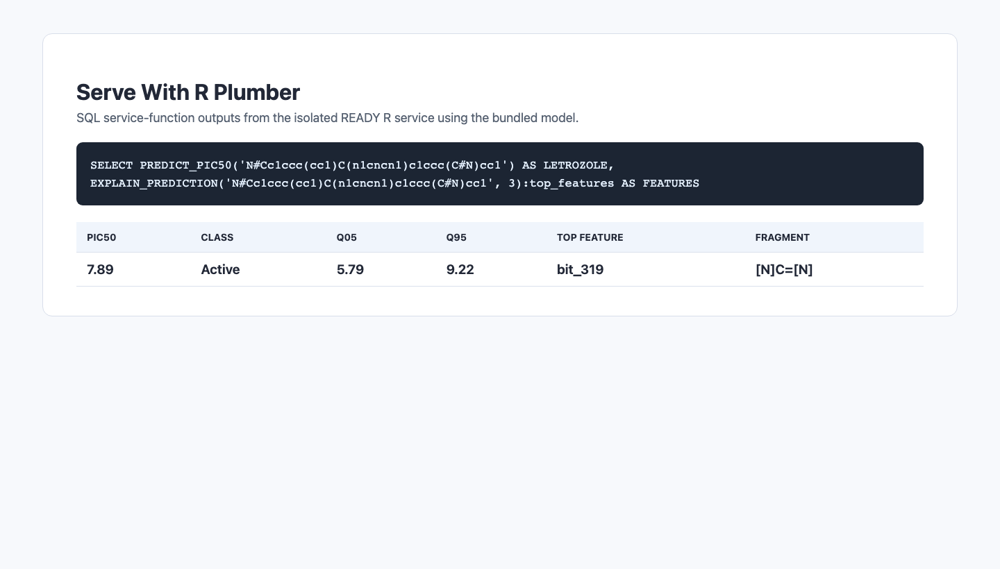

With the service running and its public ingress URL available, verify external HTTPS access with the smoke test script.

### Call the Endpoint

Public Snowpark Container Services endpoints require Snowflake authentication. For programmatic clients, generate a PAT in Snowsight under your user profile scoped to `QSAR_ROLE`, and pass it in the `Authorization` header using the exact `Snowflake Token` format shown below (sending `Bearer <your-PAT>` redirects to the browser login page instead):

```text
Authorization: Snowflake Token="<your-PAT>"
```

`/predict` expects a JSON payload of rows formatted as `{"data": [[row_index, smiles]]}`. Sending an unindexed body such as `{"smiles": "..."}` returns `{"data": []}` with HTTP 200.

**Run this step:** Export your `ingress_url` and PAT in the terminal and run `scripts/test_endpoint.py`.

```bash
export QSAR_ENDPOINT="<ingress_url from SHOW ENDPOINTS>"
export SNOWFLAKE_PAT="<your-PAT>"
python scripts/test_endpoint.py
```

**Check:** Review the expected terminal output below. When you train on Notebook 01's output, the five test rows return:

```text
health: 200 {"status":"ok","trees":500,"features":178}

compound      pIC50  class        q05   q95
letrozole      8.26  Active      5.79  9.22
anastrozole    8.64  Active      6.95  9.53
exemestane     6.21  Inactive    4.96  7.83
ethanol        5.21  Inactive    4.22  6.92
invalid           -  Invalid SMILES: not_a_smiles     -     -
```

If you served the repository's bundled snapshot (or the 180-bit split-first model trained on `data/chembl1978_cleaned.csv`), letrozole (`N#Cc1ccc(cc1)C(n1cncn1)c1ccc(C#N)cc1`) returns `7.89` (`Active`, quantiles `5.79` to `9.22`, corresponding to an approximate `IC50` of `12.9 nM`, compared with its selected measured `pIC50` of `9.15` in `CHEMBL1978_COMPOUNDS`) and exemestane returns `7.00`. In either case, all four valid molecules return numeric predictions and `not_a_smiles` returns an explicit CDK validation error.

Now that the R Plumber container is serving predictions, you can connect it to SQL service functions, score the cohort for the dashboard, and deploy the Streamlit application.

## Build The Streamlit Frontend

The Streamlit app gives lab colleagues a browser interface where they can explore the measured ChEMBL cohort first and then submit single or batch SMILES strings on demand without running R scripts locally.

### Review the App

> **Note:** The Streamlit application files in `streamlit/` are already included in the cloned repository. Review how the app separates prepared stage summaries from live R predictions before deploying it.

The `streamlit/` directory contains a multipage app designed to run in Streamlit in Snowflake on the container runtime:

- **Dashboard** (`streamlit/pages/dashboard.py`) reads prepared stage summaries (`dashboard_eda.csv`, `dashboard_ro5.csv`, `dashboard_predictions.csv`, `top_features.csv`, and `training_metrics.json`) to display class balance, Lipinski Rule-of-Five compliance, and model evaluation metrics.
- **Single Prediction** (`streamlit/pages/single_prediction.py`) sends a SMILES string (or one of five preset molecules: letrozole, anastrozole, exemestane, aspirin, or caffeine) to the R service's `/predict` endpoint, renders the 2D structure with RDKit, displays predicted `pIC50` and model quantiles, and logs the call to `QSAR_PREDICTIONS_LOG`.
- **Batch Prediction** (`streamlit/pages/batch_prediction.py`) scores multiple SMILES strings side by side in a table and downloadable CSV.
- **About** (`streamlit/pages/about.py`) documents the biological target (`CYP19A1` / `CHEMBL1978`), dataset curation, ECFP4 features, `ranger` estimator, and Snowpark Container Services deployment so scientists can inspect model provenance before trusting a score.

Review the request call in **streamlit/_shared.py** below (no action required) to see how Python forwards SMILES strings to the R service over internal Snowpark Container Services DNS and unpacks the response without reimplementing the model in Python:

```python
resp = requests.post(
    get_predict_url(),
    headers=headers,
    json={"data": [[0, smiles]]},
    timeout=60,
)
resp.raise_for_status()
_, pic50, activity, ci_lo, ci_hi = resp.json()["data"][0]
```

When running in Snowflake, `streamlit/_shared.py` discovers the service's internal DNS name automatically via `SHOW SERVICES`, so no hardcoded URL is needed. Next, create the SQL service functions and run Notebook 02 so the Dashboard has batch-scored data.

### Score Compounds

Before deploying the app, expose the R container to SQL and batch-score the `2,751` curated compounds.

Review the `PREDICT_PIC50` declaration from **sql/functions.sql** below (no action required) to see how a Snowflake service function binds SQL calls to `/sf/predict` on `QSAR_PLUMBER_SVC`:

```sql
CREATE OR REPLACE FUNCTION PREDICT_PIC50(smiles VARCHAR)
  RETURNS VARIANT STRICT SERVICE = QSAR_PLUMBER_SVC
  ENDPOINT = api MAX_BATCH_ROWS = 50 AS '/sf/predict';
```

**Run this step:** Open `sql/functions.sql` in a Snowsight SQL worksheet and run the entire script under `QSAR_ROLE`. It creates four R-backed service functions (`PREDICT_PIC50`, `ECFP4`, `SIMILAR_COMPOUNDS`, and `EXPLAIN_PREDICTION`) plus an RDKit Python user-defined function (`RO5`, pinned to `rdkit==2025.09.3` via Snowflake's PyPI artifact repository). Confirm that the verification query at the end of `sql/functions.sql` returns a letrozole `pIC50` prediction (`7.89` with the bundled model).

**Run this step:** Execute `02_score_compounds.ipynb` in Snowsight to score all `2,751` compounds in `CHEMBL1978_COMPOUNDS` using the SQL functions, populate `CHEMBL1978_PREDICTIONS`, `CHEMBL1978_FINGERPRINTS`, and `CHEMBL1978_DESCRIPTORS`, and write `dashboard_predictions.csv` to `@QSAR_STAGE`.

```sql
USE ROLE QSAR_ROLE;
USE WAREHOUSE QSAR_WH;
EXECUTE NOTEBOOK PROJECT QSAR_DB.PUBLIC.QSAR_NOTEBOOKS
    MAIN_FILE = '02_score_compounds.ipynb'
    COMPUTE_POOL = 'QSAR_ST_POOL'
    QUERY_WAREHOUSE = 'QSAR_WH'
    RUNTIME = 'V2-CPU-PY3.12'
    EXTERNAL_ACCESS_INTEGRATIONS = (QSAR_NB_EAI);
```

**Check:** In the isolated test run, all `2,751` compounds scored with zero null predictions and `2,652` Lipinski Rule-of-Five passes (the `0.469` RMSE across all `2,751` rows combines training and test molecules and is not a held-out test metric). The image below is a local rendering of that verification query result.

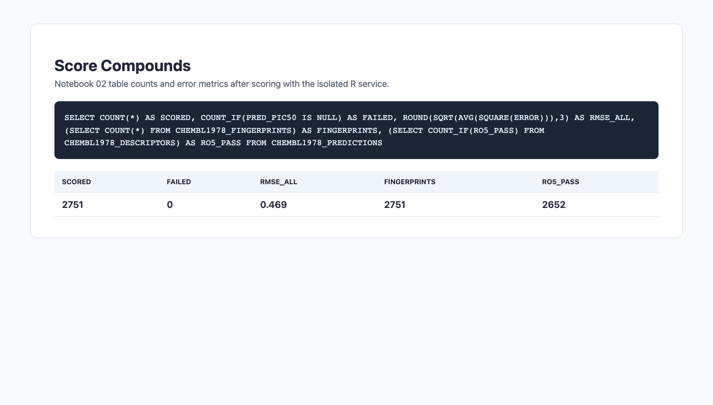

**Run this step:** From your local terminal, upload `top_features.csv` and `training_metrics.json` to `@QSAR_DB.PUBLIC.QSAR_STAGE` so the Dashboard and About pages can display feature importances and model metrics.

```bash
cp docker/top_features_rcdk.csv /tmp/top_features.csv
snow sql -q "PUT file:///tmp/top_features.csv @QSAR_DB.PUBLIC.QSAR_STAGE AUTO_COMPRESS=FALSE OVERWRITE=TRUE"
snow sql -q "PUT file://docker/training_metrics.json @QSAR_DB.PUBLIC.QSAR_STAGE AUTO_COMPRESS=FALSE OVERWRITE=TRUE"
```

> **Note:** Remember that a stage is a static file handoff, not an automatic refresh pipeline. Whenever you retrain and promote a new R model, re-run Notebook 02 and re-upload `top_features.csv` and `training_metrics.json` so the dashboard summaries match the live model. If you skipped both notebooks and served the bundled model, you can generate the stage CSVs from your laptop with `scripts/generate_dashboard_data.py` as documented in `README.md`.

With the stage files and SQL functions in place, deploy the Streamlit application.

### Deploy the App

Review the runtime configuration in **streamlit/snowflake.yml** below (no action required) to see how the app specifies the container runtime, `QSAR_ST_POOL`, and `QSAR_APP_EAI`:

```yaml
    runtime_name: SYSTEM$ST_CONTAINER_RUNTIME_PY3_11
    compute_pool: QSAR_ST_POOL
    external_access_integrations:
      - QSAR_APP_EAI
```

**Run this step:** From the `streamlit/` directory in your terminal, deploy the app to Snowflake using the Snowflake CLI.

```bash
cd streamlit
snow streamlit deploy --replace
cd ..
```

**Check:** Open the URL printed by `snow streamlit deploy` (the first load takes one to two minutes while container dependencies install) and verify each page:

1. **Dashboard:** Inspect the measured activity distribution and class balance for the `2,751` curated ChEMBL compounds before scoring individual molecules. The screenshot below is captured from the deployed Streamlit app in Snowflake.

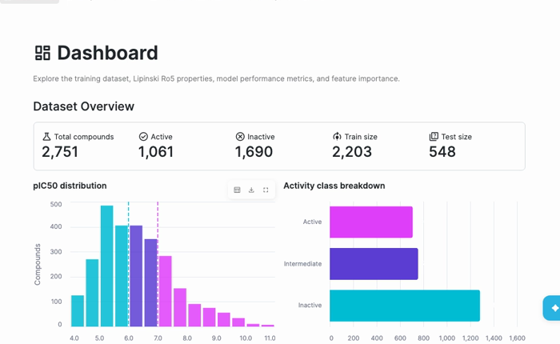

2. **Single Prediction:** Select an example molecule such as **letrozole** or **aspirin** (or paste a SMILES string) and click **Predict pIC50**. The first image below is a local preview showing letrozole (`CHEMBL1444`) scored at `7.89` (`Active`, uncalibrated quantiles `5.79` to `9.22`), followed by a screenshot captured from the deployed Streamlit app scoring aspirin at `5.21` (`Inactive`).

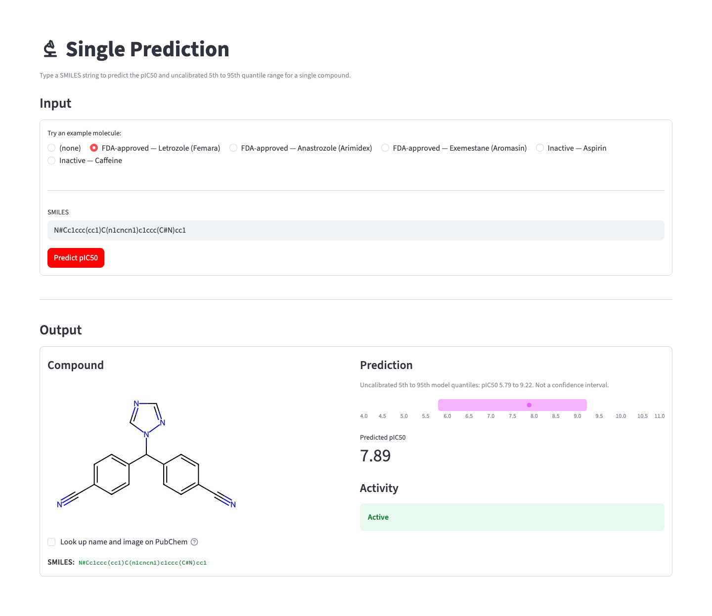

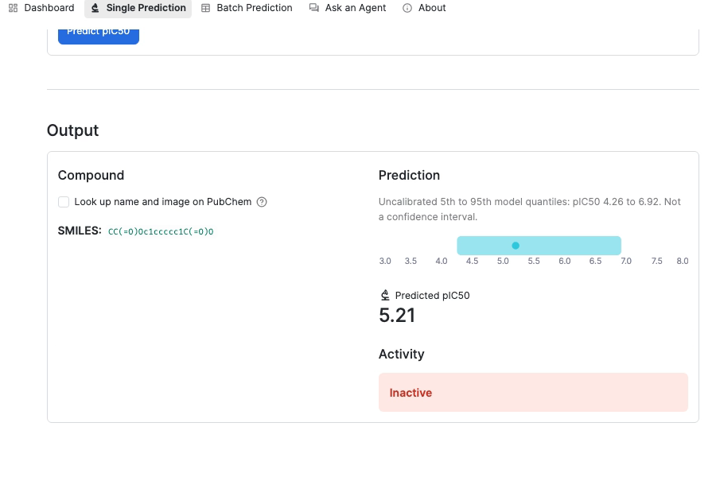

3. **Batch Prediction:** Submit multiple SMILES strings at once to compare predicted `pIC50`, activity labels, and quantile ranges in a single table. Below are the five-compound local preview and a cropped capture from the deployed Streamlit app comparing aspirin (`5.21`) and caffeine (`5.96`).

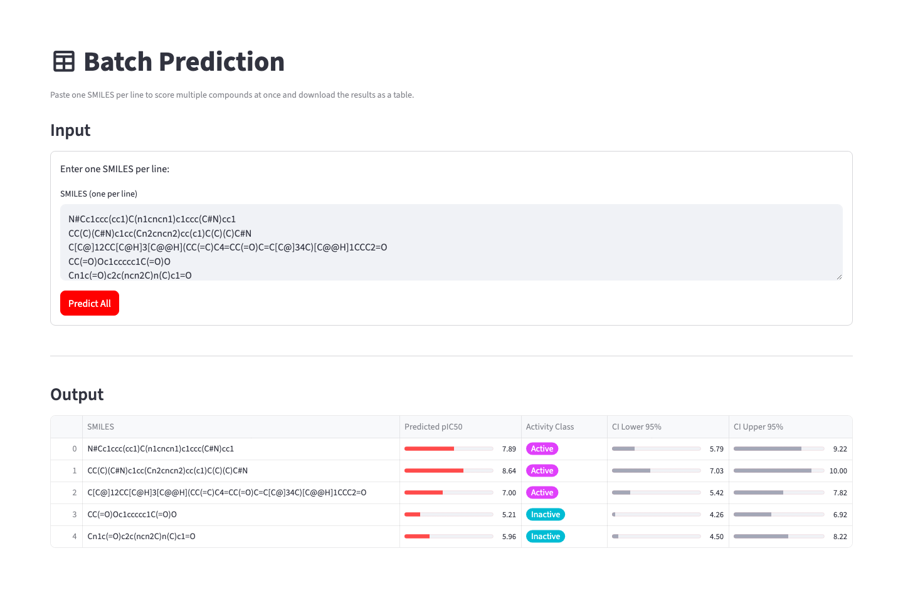

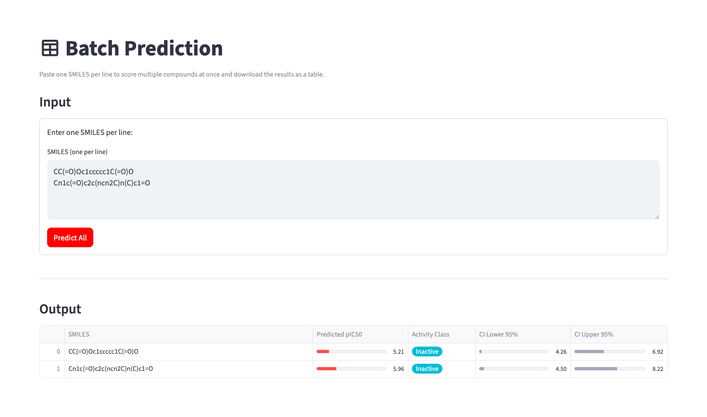

4. **About:** Review the target biology (`CYP19A1` / `CHEMBL1978`), dataset summary, 1,024-bit ECFP4 fingerprint encoding, `ranger` quantile forest parameters, and Snowpark Container Services architecture on the About page, shown in the deployed app capture below.

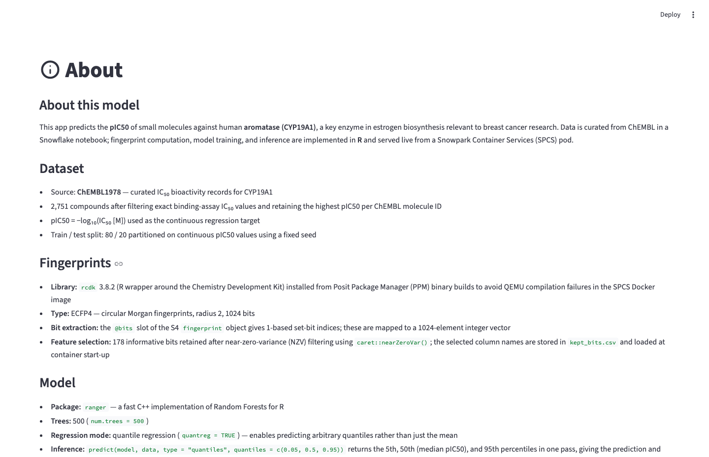

> **Note:** On Single Prediction, optional PubChem compound-name and fallback-image lookups are unchecked by default because enabling them sends a SMILES-derived InChIKey (and potentially the SMILES string) outside Snowflake. Keep that option off when evaluating proprietary structures.

That completes the core web application for lab scientists. Next, you can connect external AI chat clients directly to the R service's MCP endpoint.

## Connect AI Assistants

In addition to serving the Streamlit UI and SQL functions, `QSAR_PLUMBER_SVC` exposes a standalone MCP server at `/mcp` over JSON-RPC 2.0 so AI assistants (such as Cortex Code or Claude Desktop) can invoke R model tools from natural-language prompts.

### Inspect the MCP Tools

The `/mcp` route exposes six tools backed by the running R container:

| Tool | Purpose | Example Prompt |
|---|---|---|
| `predict_pic50` | Predict `pIC50`, activity class (`>= 6.5`), uncalibrated 5th to 95th quantiles, and approximate `IC50` in `nM` for a SMILES string | "Predict the aromatase pIC50 for letrozole: `N#Cc1ccc(cc1)C(n1cncn1)c1ccc(C#N)cc1`" |
| `validate_smiles` | Validate a SMILES string with the CDK parser and return heavy-atom count | "Is `c1ccccc1` a valid SMILES?" |
| `get_dataset_stats` | Summarize total compounds (`2,751`), active/inactive counts, and split sizes | "How many compounds are in the training data, and how many are active?" |
| `get_model_info` | Return estimator metadata (`500` trees, kept bits, held-out `test_r2`, and `test_rmse`) | "What model is this and how well does it do on the test set?" |
| `get_feature_importance` | Return the top `N` ECFP4 fingerprint bits ranked by regression impurity importance | "Which fingerprint bits matter most?" |
| `get_ro5_stats` | Report Lipinski Rule-of-Five compliance by activity class and median property values | "How do Active and Inactive compounds compare on Lipinski's Rule of Five?" |

Because MCP returns structured tool data directly from the R service, the AI client reports exact model and dataset values rather than guessing descriptors or inventing potency numbers. Next, register the `/mcp` endpoint in your client configuration.

### Register the Client

**Run this step:** Add the `qsar-aromatase` server entry to `~/.snowflake/cortex/mcp.json` (or your MCP client's configuration file), replacing `<your-ingress-url>` with the host from `SHOW ENDPOINTS IN SERVICE QSAR_DB.PUBLIC.QSAR_PLUMBER_SVC` and `<your-PAT>` with a PAT restricted to `QSAR_ROLE`.

```json
{
  "mcpServers": {
    "qsar-aromatase": {
      "transport": "http",
      "url": "https://<your-ingress-url>/mcp",
      "headers": {
        "Authorization": "Snowflake Token=\"<your-PAT>\""
      }
    }
  }
}
```

**Check:** Reconnect the server (`cortex mcp reconnect qsar-aromatase` in Cortex Code, confirming 6 tools load) and ask: "Predict the aromatase activity of letrozole, SMILES `N#Cc1ccc(cc1)C(n1cncn1)c1ccc(C#N)cc1`". Review the expected `predict_pic50` tool output below (from the notebook-trained model; the bundled model returns `7.89` and `[5.79, 9.22]`):

```text
SMILES: N#Cc1ccc(cc1)C(n1cncn1)c1ccc(C#N)cc1
pIC50:  8.26  (Active)
90% CI: [5.79, 9.22]
IC50 ~  5.5 nM
```

See `docs/mcp-walkthrough.md` in the companion repository for additional client examples and an optional Snowflake Native App packaging pattern (`native_app/`). While standalone MCP exposes the six R container tools, it does not query the full Snowflake tables or assay literature; the optional Cortex Agent in the next section adds those governed data sources inside Snowflake.

## Ask an Agent

> **Note:** This section is an optional extension. It requires the Snowflake tables created by **both** Notebook 01 (`CHEMBL1978_RAW_ACTIVITIES`, `CHEMBL1978_COMPOUNDS`, `CHEMBL1978_ASSAYS`, and `CHEMBL1978_DOCUMENTS`) and Notebook 02 (`CHEMBL1978_PREDICTIONS`, `CHEMBL1978_FINGERPRINTS`, and `CHEMBL1978_DESCRIPTORS`), plus `sql/functions.sql`. Generating dashboard CSVs from a laptop alone does not create these tables.

When a model score raises follow-up questions such as "How many compounds in the cohort were measured active?", "What assay conditions were used to measure letrozole (`CHEMBL1444`)?", or "Rank letrozole, caffeine, and aspirin for review", an in-platform Cortex Agent (`AROMATASE_AGENT`) can route each question to the right evidence source rather than mixing predictions with measurements.

### Create Agent Tools

`sql/agent.sql` builds three governed capabilities that complement the R-backed SQL functions:

1. **Measured Cohort Analytics (`AROMATASE_SV`):** Creates a Snowflake Semantic View over `CHEMBL1978_COMPOUNDS`, `CHEMBL1978_PREDICTIONS`, `CHEMBL1978_DESCRIPTORS`, `CHEMBL1978_ASSAYS`, `CHEMBL1978_DOCUMENTS`, `CHEMBL1978_FINGERPRINTS`, and `QSAR_PREDICTIONS_LOG` so Cortex Analyst answers measured active/inactive counts and potency statistics with deterministic SQL instead of estimating them from model calls.
2. **Assay and Literature Context (`ASSAY_SEARCH`):** Creates a Cortex Search service indexing assay descriptions and linked publication abstracts so the agent can retrieve experimental conditions and cite specific `ASSAY_CHEMBL_ID` and `DOCUMENT_CHEMBL_ID` identifiers (for example, showing that letrozole `CHEMBL1444` appears in cell-based assay `CHEMBL988317` as well as fluorimetric enzyme assays `CHEMBL1828368` and `CHEMBL1958525`).
3. **Candidate Triage (`TRIAGE_COMPOUNDS`):** Creates a stored procedure that accepts up to 20 newline-separated SMILES strings, combines each molecule's predicted `pIC50`, Tanimoto similarity to the nearest measured compound (`SIMILAR_COMPOUNDS`), and Lipinski Rule-of-Five compliance (`RO5`), and returns a ranked review table with an explicit rationale per row (flagging low similarity as uncertain extrapolation).

Review the verified semantic-view query excerpt from **sql/agent.sql** below (no action required) to see how measured cohort counts are queried separately from `PREDICT_PIC50`:

```sql
SELECT * FROM SEMANTIC_VIEW(QSAR_DB.PUBLIC.AROMATASE_SV
  METRICS compounds.compound_count, compounds.active_count);
```

**Run this step:** Open `sql/agent.sql` in a Snowsight SQL worksheet and execute it under `QSAR_ROLE` to create `AROMATASE_SV`, `ASSAY_SEARCH`, and `TRIAGE_COMPOUNDS`.

With the semantic view, search index, and triage procedure ready, deploy the Cortex Agent.

### Deploy the Agent

**Run this step:** From the repository root in your terminal, run `scripts/deploy_agent.py` with your Snowflake CLI connection name to create `QSAR_DB.PUBLIC.AROMATASE_AGENT` from `agent/aromatase_agent.yaml` and register it with Snowflake Intelligence.

```bash
python scripts/deploy_agent.py --connection <your_connection>
```

**Check:** Restart or redeploy the Streamlit app so the conditional **Ask an Agent** page appears in the sidebar, and ask: "How many measured aromatase compounds are active and inactive?" Cortex Analyst queries `AROMATASE_SV` and returns `1,061` measured active and `1,690` measured inactive compounds out of `2,751` total.

The first image below is a local preview of the isolated `QSAR_AG` agent response, followed by a cropped screenshot captured from the deployed Streamlit app's **Ask an Agent** page answering the measured active and inactive count question.

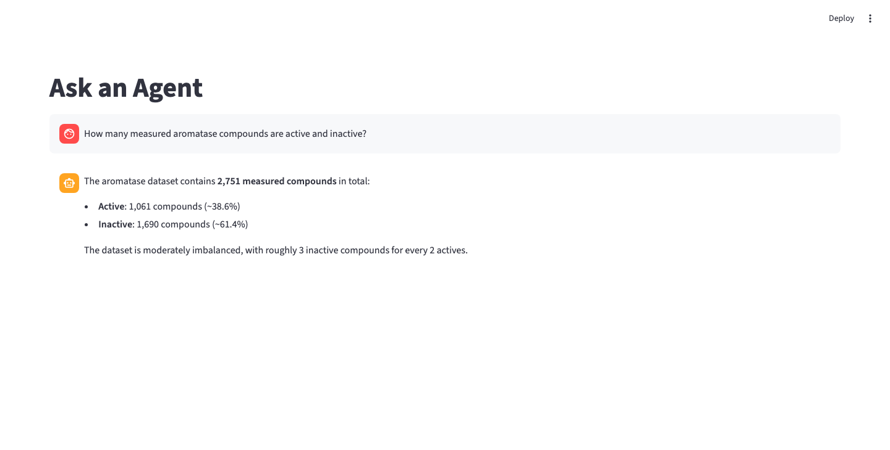

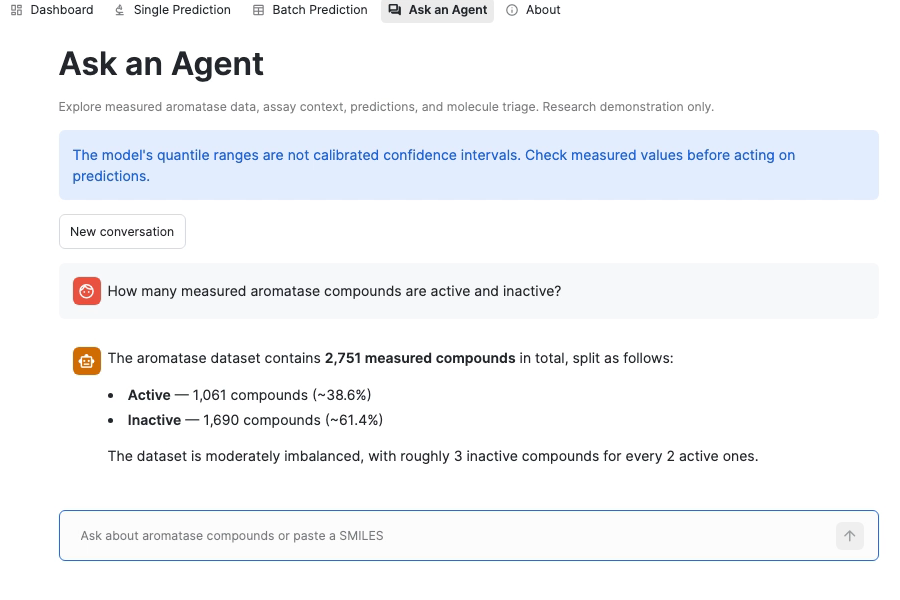

You can also test candidate triage by asking the agent to rank letrozole (`7.89 Active`, similarity `1.00` to `CHEMBL1444`, passes Rule of Five), caffeine (`5.96 Inactive`, similarity `0.24`, flagged for low similarity), and aspirin (`5.21 Inactive`, similarity `0.35`, flagged for low similarity). Next, run the 15-case evaluation suite to measure the agent's routing and answer quality.

### Evaluate the Agent

To evaluate `AROMATASE_AGENT` systematically, the repository provides 15 benchmark questions in `agent/eval_questions.sql` and an evaluation configuration in `agent/eval_config.yaml` (note that the expected prediction numbers in `agent/eval_questions.sql` match the bundled model, so adjust them if you trained on Notebook 01's row order).

**Run this step:** As `ACCOUNTADMIN` in Snowsight, grant `QSAR_ROLE` the Cortex Agent database role and `EXECUTE TASK` privilege required by `EXECUTE_AI_EVALUATION`.

```sql
USE ROLE ACCOUNTADMIN;
GRANT DATABASE ROLE SNOWFLAKE.CORTEX_AGENT_USER TO ROLE QSAR_ROLE;
GRANT EXECUTE TASK ON ACCOUNT TO ROLE QSAR_ROLE;
```

**Run this step:** Run `agent/eval_questions.sql` in a Snowsight worksheet to populate `AGENT_EVAL_QUESTIONS`, then upload `agent/eval_config.yaml` to `@QSAR_DB.PUBLIC.QSAR_STAGE` from your terminal.

```bash
snow sql -q "PUT file://agent/eval_config.yaml @QSAR_DB.PUBLIC.QSAR_STAGE AUTO_COMPRESS=FALSE OVERWRITE=TRUE"
```

**Run this step:** Start the evaluation run and poll its status from your Snowsight worksheet.

```sql
USE ROLE QSAR_ROLE;
USE WAREHOUSE QSAR_WH;
CALL EXECUTE_AI_EVALUATION('START', OBJECT_CONSTRUCT('run_name', 'aromatase-guide-eval'),
  '@QSAR_DB.PUBLIC.QSAR_STAGE/eval_config.yaml');
CALL EXECUTE_AI_EVALUATION('STATUS', OBJECT_CONSTRUCT('run_name', 'aromatase-guide-eval'),
  '@QSAR_DB.PUBLIC.QSAR_STAGE/eval_config.yaml');
```

**Check:** Once `STATUS` reports `COMPLETED`, query the evaluation metrics in SQL (for repeat runs on the same dataset, remove the `dataset` block from `eval_config.yaml` and pick a new `run_name`).

```sql
SELECT INPUT, METRIC_NAME, EVAL_AGG_SCORE, METRIC_STATUS
FROM TABLE(SNOWFLAKE.LOCAL.GET_AI_EVALUATION_DATA(
  'QSAR_DB', 'PUBLIC', 'AROMATASE_AGENT', 'CORTEX AGENT', 'aromatase-guide-eval'))
WHERE METRIC_NAME IS NOT NULL
ORDER BY INPUT, METRIC_NAME;
```

In the isolated prototype run (`aromatase_verified_20261108`), all 15 evaluation cases completed with mean answer correctness `0.956`, logical consistency `0.956`, and tool selection `0.967`, as shown in the local result rendering below. Remember that these scores measure agent tool routing and response fidelity, not the chemical accuracy of the underlying QSAR forest.

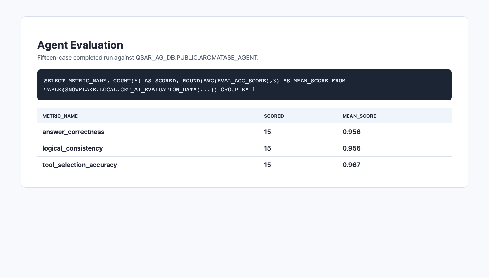

Before sharing the app, MCP server, or agent with other scientists, review the statistical, operational, and governance boundaries of this system.

## Review Model Limitations

A demo only needs to succeed once, whereas a system that other scientists depend on must disclose its statistical limitations, protect sensitive chemical structures, and stay observable over time.

### Scientific and Statistical Limits

Disclose these modeling caveats wherever predictions are displayed or shared:

- **Paired model and feature contract:** The `docker/train_rcdk.R` script splits the dataset 80/20 before running `nearZeroVar()` on training molecules only (retaining `180` bits on `data/chembl1978_cleaned.csv` with held-out `test_r2: 0.6843` and `test_rmse: 0.7721`). The pre-bundled `docker/` model was trained with `nearZeroVar()` before the split (`178` bits, `test_r2: 0.6855`, `test_rmse: 0.7708`). Never mix a `.rds` model file from one run with the `kept_bits.csv` list from another.
- **Single row-order-dependent split:** The 80/20 split is drawn by row position with a fixed seed (`42`). The same `2,751` compounds ordered by Notebook 01 produce `test_r2: 0.6537` and `test_rmse: 0.7949`. A single random split does not validate generalization to new chemical scaffolds; use scaffold splitting and cross-validation for release-grade evaluation.
- **Reported R2 is squared correlation:** `test_r2` is computed as `cor(pred, y)^2`, not the conventional coefficient of determination `1 - SSE/SST`.
- **Uncalibrated model quantiles:** The 5th to 95th percentile range from the quantile forest (labeled `90% CI` in the API response) reflects empirical tree spread and has not been calibrated for statistical coverage on held-out molecules.
- **No formal applicability domain gate:** Out-of-domain molecules such as ethanol receive a numeric `pIC50` prediction (`5.21`) rather than being rejected. Nearest-measured-compound Tanimoto similarity in `SIMILAR_COMPOUNDS` and `TRIAGE_COMPOUNDS` is a review heuristic, not a validated applicability-domain boundary.
- **Held-out misses on steroidal inhibitors:** Steroids make up `682` of the `2,751` compounds (`31%` active vs `39%` overall). Exemestane (`CHEMBL1200374`, measured `pIC50` `7.82`) lands in the held-out test split when trained on Notebook 01's output and is predicted at `6.21` (`Inactive`), whereas the bundled split includes exemestane in training and predicts `7.00`. Always cross-check predictions against measured ChEMBL records.

Alongside these statistical boundaries, apply five operational and governance checks before inviting broader use.

### Governance and Release Checks

Shipping AI in a regulated drug discovery environment requires addressing procurement and platform constraints, keeping proprietary chemistry inside governed boundaries, and planning for ongoing operations and cost. Use these five checks as a repeatable blueprint to move from a teaching prototype to a production system that real scientists can depend on daily:

1. **Data and Reproducibility:** Version the governed enterprise tables, the ChEMBL snapshot, curation rules (such as highest-`pIC50` deduplication), activity cutoff (`6.5`), and assay/document provenance so every stage from preprocessing to scoring can be reproduced and audited later.
2. **Science and Validation:** Freeze the ordered feature bit list (`kept_bits.csv`), calibrate uncertainty intervals, and evaluate on untouched chemical scaffolds rather than relying on a single row-order-dependent split.
3. **Artifact and Architectural Tradeoffs:** Pin R package repositories, container digests, and model files together, and regenerate stage CSVs (`dashboard_predictions.csv`, `top_features.csv`, `training_metrics.json`) whenever the model changes. Rather than rewriting the R model in Python or building an R Shiny frontend from scratch, containerizing R Plumber behind a Python Streamlit UI and an MCP endpoint preserves exact `rcdk` and `ranger` parity while meeting enterprise platform constraints (and if per-consumer isolation is needed across accounts, `native_app/` provides a Snowflake Native App packaging path).
4. **Access, Guardrails, and Private Chemistry:** Keep external PubChem lookups opt-in (off by default) and enforce network rules so proprietary chemical structures stay inside your enterprise data platform and private or managed models; cap batch and triage inputs (such as 20 SMILES per `TRIAGE_COMPOUNDS` call); and note that `QSAR_PREDICTIONS_LOG.USER_NAME` in Streamlit in Snowflake records the service identity rather than the individual viewer unless caller identity is captured explicitly.
5. **Ownership, Monitoring, and Cost Control:** Assign owners to monitor container readiness, API latency, and model or pipeline drift against new wet-lab assays (`/health` confirms container liveness, not chemical validity), and control compute spend as usage grows by right-sizing compute pools (`CPU_X64_S` and `CPU_X64_XS`), configuring auto-suspend (`AUTO_SUSPEND_SECS = 3600`), and tracking warehouse and Cortex Search credit consumption.

Once you finish exploring the application and its evaluation checks, tear down the Snowflake resources to stop compute pool billing.

## Clean Up

Compute pools bill while they have active nodes. Run the statements below to remove all objects created in this guide.

**Run this step:** If you completed the optional `Ask an Agent` section, first remove `AROMATASE_AGENT` from Snowflake Intelligence and drop the agent, search service, and evaluation objects.

```sql
USE ROLE QSAR_ROLE;
ALTER SNOWFLAKE INTELLIGENCE SNOWFLAKE_INTELLIGENCE_OBJECT_DEFAULT
  DROP AGENT QSAR_DB.PUBLIC.AROMATASE_AGENT;
DROP AGENT IF EXISTS QSAR_DB.PUBLIC.AROMATASE_AGENT;
DROP CORTEX SEARCH SERVICE IF EXISTS QSAR_DB.PUBLIC.ASSAY_SEARCH;
-- If you ran the optional evaluation, also drop its dataset and source table.
DROP DATASET IF EXISTS QSAR_DB.PUBLIC.AROMATASE_EVAL_DATASET;
DROP TABLE IF EXISTS QSAR_DB.PUBLIC.AGENT_EVAL_QUESTIONS;
```

**Run this step:** Drop the Streamlit app, the R Plumber service, the notebook project, the compute pools, the integrations, the database, the warehouse, and `QSAR_ROLE`.

```sql
USE ROLE QSAR_ROLE;
DROP STREAMLIT IF EXISTS QSAR_DB.PUBLIC.QSAR_AROMATASE_APP;
DROP SERVICE IF EXISTS QSAR_DB.PUBLIC.QSAR_PLUMBER_SVC;
DROP NOTEBOOK PROJECT IF EXISTS QSAR_DB.PUBLIC.QSAR_NOTEBOOKS;
DROP STAGE IF EXISTS QSAR_DB.PUBLIC.NB_PROJECT_STAGE;

USE ROLE ACCOUNTADMIN;
DROP COMPUTE POOL IF EXISTS QSAR_CPU_POOL;
DROP COMPUTE POOL IF EXISTS QSAR_ST_POOL;
DROP INTEGRATION IF EXISTS QSAR_APP_EAI;
DROP INTEGRATION IF EXISTS QSAR_NB_EAI;
DROP DATABASE IF EXISTS QSAR_DB;
DROP WAREHOUSE IF EXISTS QSAR_WH;
DROP ROLE IF EXISTS QSAR_ROLE;
```

If you ran a notebook interactively in Snowsight Workspaces, stop its notebook service before dropping `QSAR_ST_POOL`. Also revoke any PAT you created for this tutorial under your user profile in Snowsight.

With your environment cleaned up, review the key takeaways and reference materials below.

## Conclusion And Resources

Congratulations! You've successfully taken an R-based drug discovery model from exploratory lab code to a governed, containerized application on Snowflake, combining a reproducible R pipeline (`rcdk` ECFP4 fingerprints, `ranger` quantile random forest, and R Plumber on Snowpark Container Services) with Python data curation, a Streamlit frontend, a six-tool MCP server, and an optional Cortex Agent so bench scientists and AI assistants can query interpretable predictions without touching code.

### What You Learned
- How to structure an R machine learning pipeline into deterministic, testable stages (data preprocessing, molecular feature engineering, model training, and scoring) against governed enterprise tables rather than local CSVs
- How to combine R and Python harmoniously so R remains first-class for cheminformatics and modeling while Python and Streamlit provide an intuitive web interface
- How to containerize an R model, its pinned dependencies, and its ordered feature bit list on Snowpark Container Services and authenticate external requests with a PAT
- How to surface the same containerized R pipeline through SQL service functions, a multipage Streamlit app, a conversational MCP endpoint, and an optional Cortex Agent that separates measured cohort data, retrieved assay literature, and model predictions
- How to apply a repeatable production blueprint for regulated domains: keeping proprietary chemistry in-house, monitoring model and pipeline health, controlling compute cost, and disclosing statistical limitations so R pipelines remain reproducible, auditable, and trusted

Next, explore the companion source code, Snowflake documentation, and published aromatase QSAR literature below to build on this workflow.

### Related Resources
- [Companion GitHub Repository: qsar-r-py-snowflake](https://github.com/sfc-gh-cnantasenamat/qsar-r-py-snowflake)
- [Snowpark Container Services Overview](https://docs.snowflake.com/en/developer-guide/snowpark-container-services/overview)
- [Access a Public Endpoint Programmatically](https://docs.snowflake.com/en/developer-guide/snowpark-container-services/tutorials/advanced/tutorial-8-access-public-endpoint-programmatically)
- [Programmatic Access Tokens](https://docs.snowflake.com/en/user-guide/programmatic-access-tokens)
- [Streamlit in Snowflake Documentation](https://docs.snowflake.com/en/developer-guide/streamlit/about-streamlit)
- [ChEMBL Bioactivity Database (Target CHEMBL1978)](https://www.ebi.ac.uk/chembl/)
- [RCSB Protein Data Bank Structure 3EQM: Human Placental Aromatase](https://www.rcsb.org/structure/3EQM)
- [Schaduangrat N, Lampa S, Simeon S, Gleeson MP, Spjuth O, Nantasenamat C. Towards reproducible computational drug discovery. J Cheminform (2020)](https://link.springer.com/article/10.1186/s13321-020-0408-x)
- [Shoombuatong W, Schaduangrat N, Nantasenamat C. Towards understanding aromatase inhibitory activity via QSAR modeling. EXCLI J (2018)](https://pmc.ncbi.nlm.nih.gov/articles/PMC6123608/)
- [Simeon S, et al. Origin of aromatase inhibitory activity via proteochemometric modeling. PeerJ (2016)](https://peerj.com/articles/1979/)
- [Shoombuatong W, et al. Prediction of aromatase inhibitory activity using the efficient linear method (ELM). EXCLI J (2015)](https://pmc.ncbi.nlm.nih.gov/articles/PMC4614109/)
- [Worachartcheewan A, et al. Large-scale QSAR study of aromatase inhibitors using SMILES-based descriptors. Chemom Intell Lab Syst (2014)](https://www.sciencedirect.com/science/article/abs/pii/S0169743914001646)
